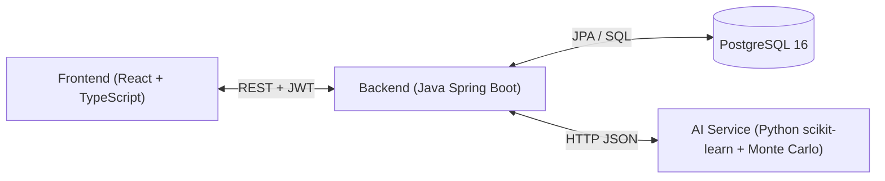

# System Architecture & Database Design

## High-Level Architecture

## Database Schema (PostgreSQL)

- `users`: Tài khoản người dùng (`id`, `email`, `password_hash`, `full_name`, `avatar_url`, `role`, `created_at`).
- `projects`: Dự án (`id`, `key`, `name`, `description`, `owner_id`, `created_at`).
- `project_members`: Thành viên thuộc dự án (`project_id`, `user_id`, `role`).
- `sprints`: Chu kỳ Sprint (`id`, `project_id`, `name`, `goal`, `status`, `start_date`, `end_date`, `created_at`).
- `issues`: Công việc/Task (`id`, `project_id`, `sprint_id`, `issue_key`, `title`, `description`, `type`, `status`, `priority`, `difficulty`, `estimated_hours`, `actual_hours`, `story_points`, `ai_suggested_points`, `ai_confidence`, `ai_metadata`, `position`, `assignee_id`, `reporter_id`, `created_at`, `updated_at`, `completed_at`).
- `comments`: Bình luận trong từng Issue (`id`, `issue_id`, `author_id`, `content`, `created_at`).

## AI Estimation Flow

1. Frontend gửi thông tin task (`title`, `description`, `issue_type`, `priority`, `difficulty`, `estimated_hours`) lên Spring Boot.
2. Spring Boot truy vấn danh sách các task đã `DONE` trong cùng Project từ PostgreSQL và chuyển tiếp sang Python AI Service.
3. Python AI Service:
   - Nếu Project có `< 15` task `DONE`: dùng **Pre-trained Baseline Model** kết hợp **PERT + Monte Carlo**.
   - Nếu Project có `>= 15` task `DONE`: huấn luyện/dùng mô hình `scikit-learn` riêng của Project (`TfidfVectorizer` + `OneHotEncoder` + `StandardScaler` + `RandomForestRegressor`).
   - Chạy **5.000 lượt mô phỏng Monte Carlo** để trả về phân phối xác suất theo thang Fibonacci (`1, 2, 3, 5, 8, 13, 21`), `P50`, `P85`, và **Top 3 task tương tự** (Cosine Similarity).
